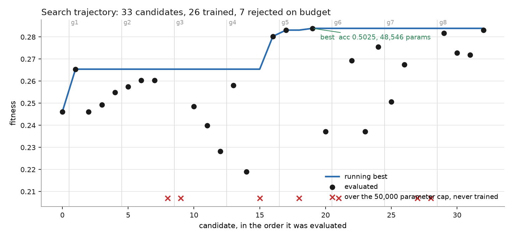
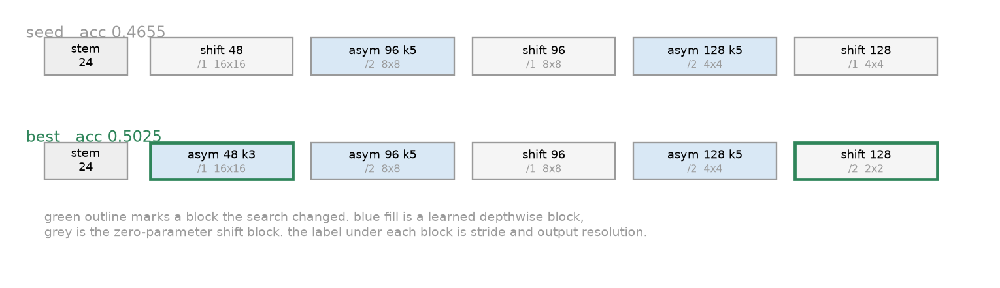
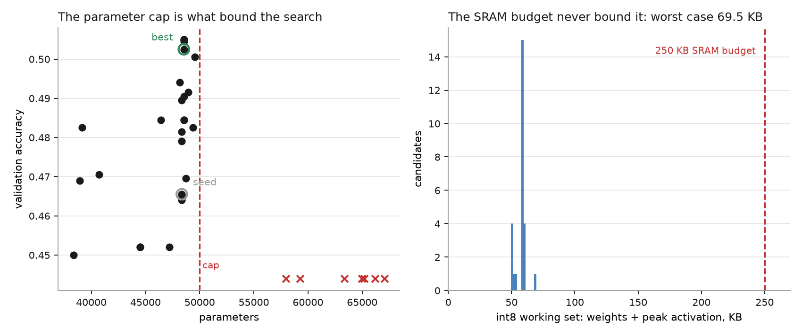
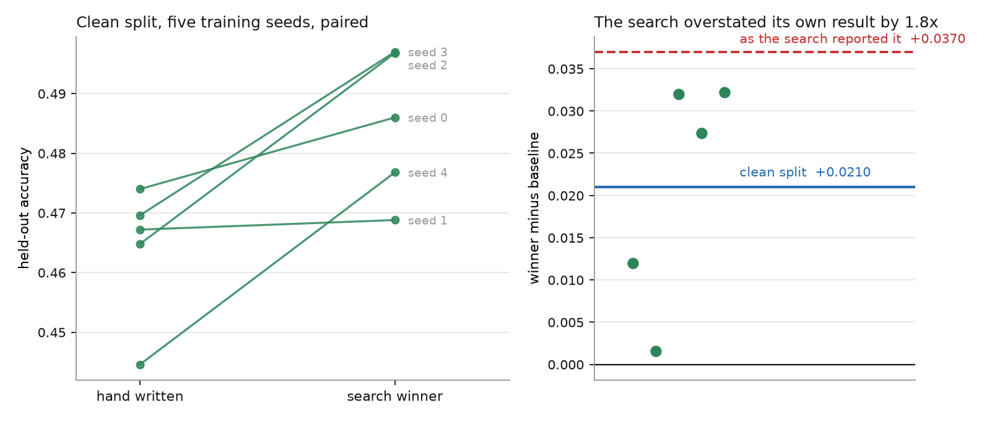
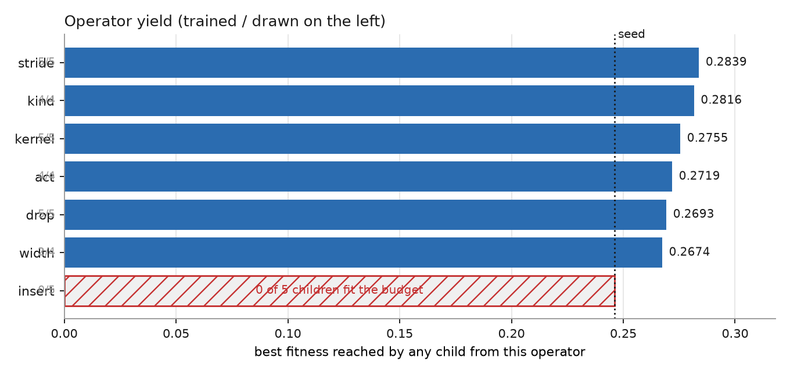

# ENAS for microcontrollers

Evolutionary architecture search under a hard 50,000 parameter budget. I kept
the failed candidates and the search's own flaws in the log.

[](https://github.com/aghasalim/enas-microcontroller/actions/workflows/ci.yml)
[](LICENSE)
[](https://doi.org/10.5281/zenodo.23003622)

I started from a baseline I wrote by hand for a Cortex-M class device and
mutated it one edit at a time. Each child gets a short training run on CIFAR-10.
Anything that wouldn't fit the device budget gets rejected before a single
gradient step is spent on it. The search improved the baseline by 3.7 accuracy
points at the same footprint. But it also selected on the test split, used one
training seed, and evaluated on only 2,000 images. Those three problems are big
enough that most of this README is about them.

All 33 candidates are in [`results/search_log.csv`](results/search_log.csv),
including the 7 rejected and the 4 evaluated twice. Every number
and figure below comes from that file, and [`check_numbers.py`](check_numbers.py)
fails the build if they disagree. The published figures are also recomputed from
the raw logs by separate implementations in `verify/`, and CI fails if anything
disagrees.

## 1. Objective

Let $m$ be an architecture, $\mathrm{Acc}(m)$ its validation accuracy,
$P(m)$ its parameter count, $M(m)$ its multiply-accumulates for one 32x32 input,
and $A(m)$ the largest single activation tensor any layer produces. The search
maximises

$$\mathcal{F}(m) = \mathrm{Acc}(m) - \beta \log_{10} P(m) - \gamma \log_{10} M(m),
\qquad \beta = \gamma = 0.02$$

with two constraints. A candidate that breaks either one is rejected outright.

$$P(m) \le 50{,}000 \qquad\text{and}\qquad P(m) + A(m) \le 250\text{ KB at int8}$$

A model that breaks either one can't be flashed at all, so it scores $-\infty$. I didn't use soft
penalties, because then an undeployable model could still win whenever its
accuracy gain is bigger than the penalty. The rejection also happens before
training, so an infeasible candidate costs no compute.

I measure $A(m)$ with forward hooks as the largest tensor any module outputs. People usually quote the weight count, but it's
the activations that make a deployment fail. A real arena allocator would do
better by reusing buffers, so this is an upper bound on the working set.

## 2. Search space

A genome is a plain dict:

```python
{"stem_width": 24, "act_shift": 4,
 "blocks": [{"kind": "shift", "out": 48, "stride": 1, "k": 3}, ...]}
```

That way every mutation is an edit I can log, diff and replay, and I can rebuild
any architecture in the run from its genome alone. Replaying the 33 logged
mutations reproduces
[`results/best_genome.json`](results/best_genome.json) exactly, and there's a test for that.

There are seven operators. Each child gets exactly one edit, so any change in
fitness has a single cause.

| operator | edit |
| --- | --- |
| `width` | output channels of one block, from {16, 24, 32, 48, 64, 96, 128, 160} |
| `kernel` | depthwise kernel of one block, from {3, 5, 7} |
| `kind` | flip one block between `shift` and `asym` |
| `act` | activation leak exponent, from {2, 3, 4, 5} |
| `insert` | add a block after position i |
| `drop` | remove block i |
| `stride` | flip one block between stride 1 and 2, capped at 3 downsamples |

`kernel` only targets `asym` blocks. Shift blocks have no spatial weights, so a
kernel edit on one gives a model identical to its parent and wastes a training
slot. I picked both block types because they're cheap on the device.

- `shift` replaces the spatial half of a convolution with `torch.roll` over five
  channel groups, following Wu et al. (2018). It has no weights and no
  multiplies, and on the device it's just pointer arithmetic.
- `asym` gets a $k \times k$ depthwise receptive field from a $1 \times k$ then a
  $k \times 1$, the factorisation from Szegedy et al. (2016) applied to the
  depthwise convolutions of Howard et al. (2017). It needs ten weights per channel where a full kernel needs 25 at $k = 5$. The intermediate also never exists at full width,
  and that matters more for peak SRAM than the weight saving.

The activation is a ReLU6 with a leak of $2^{-s}$. In an int8 pipeline that
constant is an arithmetic right shift with no multiply. The clamp keeps the
output range fixed, so the activation folds into requantisation.

## 3. Protocol

| | |
| --- | --- |
| dataset | CIFAR-10, 8,000 training images (16% of the split), 2,000 validation |
| **validation source** | **the official test split, see section 6** |
| epochs per candidate | 3 |
| optimiser | AdamW, lr 3e-3, weight decay 5e-4 (Loshchilov and Hutter, 2019) |
| schedule | OneCycle over all steps (Smith and Topin, 2019), gradient clip 1.0 |
| augmentation | random crop 32 with padding 4, random horizontal flip |
| batch size | 128 train, 256 eval |
| **training seeds** | **1, fixed at 0 for every candidate, see section 6** |
| search | 8 generations, 4 children, hill climb on best-so-far |
| hardware | Apple M4, CPU only, 4 threads, torch 2.13.0 |
| wall clock | 65 minutes of training over 33 candidates |

I set the seed before building the model, so weight initialisation is covered
by the seed. Four genomes got evaluated twice during the run, and all four gave
byte-identical accuracy, which shows this works.

## 4. Result

| | accuracy | parameters | MACs | peak activation | fitness |
| --- | ---: | ---: | ---: | ---: | ---: |
| seed, hand written | 0.4655 | 48,354 | 1,920,768 | 12,288 | 0.2461 |
| **best found** | **0.5025** | 48,546 | **1,761,024** | 12,288 | **0.2839** |

The winner gains 3.7 accuracy points and uses 8.3% fewer multiply-accumulates
for 192 more parameters. It was found at generation 5, candidate 2.

That 3.7 is what the search itself reported, and it's too high. When I retested
on a split held out of the training data, over five training seeds, the gap
was **2.1 points** instead of 3.7. The winner is still better on all five seeds, but
the search overstated its own result by 1.8x. Section 6 has the retest and the
reason.

Treat 0.5025 as a ranking score. Three epochs on 16% of the
training set at under 50,000 parameters is a budget I picked so a 33 candidate
search would take about an hour. That's enough to put architectures in order,
but not enough to say what any of them is really worth. In section 6 I retrain
the winners properly, 12 epochs on 40,000 images, and those are the real
accuracies.



## 5. What changed, and what the ablations support



Two edits separate the winner from the baseline. Block 0 went from a zero-parameter shift block to a learned asymmetric depthwise block, and block 4
gained a stride. It didn't get there in two steps, though. Block 3's stride went
from 2 to 1 in generation 1, which was the first improvement found, and then back
to 2 in generation 5, the last one. So four generations went into a change that
was later undone.

Learned spatial filtering helps at high resolution but not at low resolution.
Both conversions below came from the same parent in the same generation, so they
make a fair pair.

| edit | position | resolution | accuracy | change |
| --- | --- | --- | ---: | ---: |
| `kind block0 shift->asym` | first block | 16x16 | 0.5045 | +0.0150 |
| `kind block4 shift->asym` | last block | 4x4 | 0.4825 | -0.0070 |

Parent accuracy was 0.4895. The last-block conversion came up again in generation 8
from a stronger parent and lost again (0.5005 against 0.5025), so the direction
held both times. Both changes are inside the noise band I work out in section 6.

The gain seems to come from having learned filters early. A bigger receptive
field didn't help. Once block 0 was learned, widening its kernel from 3 to 7 in
generation 7 dropped accuracy from 0.5025 to 0.4695.

The default activation survived, but I didn't sweep it cleanly. Against the
generation 1 parent the default $2^{-4}$ beat $2^{-2}$ (0.4640) and $2^{-5}$
(0.4815), and against the final parent it beat $2^{-5}$ again (0.4905 against
0.5025). But $2^{-3}$ was only ever tried against the seed, which was the weakest
parent in the run, and there it won (0.4790 against 0.4655). I haven't tested
$2^{-3}$ on any strong topology.

The parameter cap was what limited the search. The SRAM budget never did.



All 7 rejections came from the parameter cap. No candidate got close to the
250 KB SRAM budget. The worst working set I saw was 69.5 KB, and the winner is at
59.4 KB. So the search spent the whole run up against one constraint while the
other had 3.6x headroom. The next run I'd do is raise the parameter cap until both
limits bind at once.

## 6. Threats to validity

This section decides how much to trust section 4, and three of the problems
here are just mistakes in how I set things up.

I ran selection on the test split. `loaders()` builds the validation set from
`CIFAR10(train=False)`, so every candidate was ranked on 2,000 images from the
official CIFAR-10 test set. That's model selection on test. The relative
comparisons in section 5 are less affected, since every candidate was scored on
the same 2,000 images. But 0.5025 is an optimistic estimate of held-out accuracy
and shouldn't be quoted as one.

Close to half of the ranking signal is evaluation noise. Accuracy on
$n = 2{,}000$ has a binomial standard deviation of about 0.0112 near $p = 0.48$.
The observed standard deviation across the 26 trained candidates is 0.0175. So
evaluation noise explains roughly 41% of the variance between candidates. That
leaves about 0.0134 for architecture, initialisation and everything else
together. With this evidence, I can't separate any single comparison in section
5 smaller than about 0.02 from noise.

The headline gap is weaker than it looks. 0.0370 against a pooled standard
error of 0.0158 is $z = 2.34$. It's also the maximum of 26 draws, and correcting
for taking a maximum makes it weaker still.

I only used one training seed. Every candidate was trained from seed 0, so
architecture quality is mixed up with initialisation luck, and nothing in the
search log can separate them.

### What the retest found

I wrote [`experiments/validate_winner.py`](experiments/validate_winner.py) to
measure the first and third of those. It retrains the baseline and the winner
with validation taken from the training split, never touching the test split,
across 5 training seeds. The optimiser, schedule, augmentation, epoch count and
8,000 image budget are the same as in the search, so only the split and the seed
change.



| | mean | sd across seeds |
| --- | ---: | ---: |
| baseline | 0.4640 | 0.0114 |
| winner | 0.4851 | 0.0124 |

| paired difference, by training seed | | | | |
| ---: | ---: | ---: | ---: | ---: |
| +0.0120 | +0.0016 | +0.0320 | +0.0274 | +0.0322 |

Mean +0.0210, standard error 0.0061, paired $t(4) = 3.45$, two-sided
$p = 0.026$, and the winner is ahead on 5 of 5 seeds. Pairing matters here. Both
architectures share an initialisation seed, so the difference is measured within each seed.

I took three things from this.

The result holds up. The winner really is better than my hand-written baseline
on every seed I tried, and what I said about its structure in section 5 still
stands.

The search overstated it by 1.8x. The clean split gives +0.0210, and the search
reported +0.0370. Most of that difference comes from selecting on the test split.
The search picked the candidate that did best on the same 2,000 images it was
judged on.

A single-seed comparison couldn't have settled this. The winner's own
spread across seeds is 0.0124, which is 59% of the 0.0210 effect. Every one of
the 33 decisions in the search was made from one seed, with noise more than half
the size of what was being measured. At seed 1 the gap is +0.0016, which is
basically nothing. If the search had run from that seed, it probably wouldn't
have kept this mutation.

Five seeds is a weak test, and it only bounds the gap loosely. It's enough to
show the direction is real and the size was wrong. It isn't enough to give an
interval worth quoting.

The search is a hill climb over 26 trained samples. With 8 generations, 4
children and one edit per child it only explores a narrow path, and a different
seed would probably end up somewhere else. The CPU run also had no random search
baseline. Li and Talwalkar (2019) and Yu et al. (2020) show that this comparison
is what most often wipes out a reported NAS gain. The rerun below adds one.

### The rerun with five seeds and a random baseline

Because of those two problems I did a second run on a rented RTX 3090
(`make search-gpu`, logs in [`results/search_log_gpu.csv`](results/search_log_gpu.csv),
[`results/random_log_gpu.csv`](results/random_log_gpu.csv) and
[`results/run_gpu.log`](results/run_gpu.log)). The search space, fitness and
training budget per candidate are the same. I changed three things.

- Every candidate is trained from 5 seeds and ranked on the mean, so one lucky
  initialisation can't win a generation.
- Validation comes from the training split, so the test split is never opened.
- A random search of the same size runs next to the hill climb. It uses the seed
  genome plus 33 uniform draws from the space, with 3 of them rejected as
  undeployable.

The hill climb took 573 s and the random search 664 s of training. I then
retrained both winners on seeds 100 to 104, which neither search had seen, with
[`experiments/validate_winner.py`](experiments/validate_winner.py) on the clean
split from the retest above ([`results/rescore_gpu.csv`](results/rescore_gpu.csv)).
I needed that step because both winners were picked on the same 5 seeds they were
scored on. Their search scores have the same selection bias as the first problem
in section 6.

| on seeds 100 to 104 | mean | sd | params |
| --- | ---: | ---: | ---: |
| baseline | 0.4712 | 0.0049 | 48,354 |
| hill climb winner | 0.4960 | 0.0074 | 49,762 |
| random search winner | 0.4667 | 0.0097 | 44,810 |

| paired against the baseline | gap | se | $t(4)$ | ahead on |
| --- | ---: | ---: | ---: | ---: |
| hill climb winner | +0.0249 | 0.0036 | 6.93 | 5 of 5 |
| random search winner | -0.0045 | 0.0059 | -0.76 | 2 of 5 |

The hill climb clearly beats random search. 33 random draws found nothing better
than the hand baseline. The average deployable random draw scored 0.3944. So the
baseline was already a good point in this space, and moving away from it at
random mostly makes things worse. The mutation search starts from the baseline
and changes one thing at a time, and it found +0.0249 that holds on seeds it never
saw.

Selection still pushed the search score up. On its own 5 search seeds the hill
climb winner was +0.0340 over the baseline. On fresh seeds it's +0.0249. So about
a quarter of what the search reported came from picking the luckiest of 33
candidates. Using five seeds per candidate made that bias smaller but didn't get
rid of it, so the fresh seed numbers are the ones I'd quote.

The 5 seed winner is a different network from the 1 seed winner. It keeps the
baseline's widths and strides and turns blocks 0 and 4 into asymmetric
convolutions, so four of the five blocks are asymmetric. It also shrinks block 1's
kernel from 5 to 3 and grows block 3's from 5 to 7
([`results/best_genome_gpu.json`](results/best_genome_gpu.json)). Section 7 still exports the CPU winner, and the GPU winner hasn't been through the C
path.

### Two more search seeds, and full training

One search finding +0.025 could have been luck, so I ran the hill climb twice
more from search seeds 1 and 2 on an RTX A5000. Each run had its own mutation
order, training seeds and validation split. I rescored each winner on seeds
100 to 104 exactly as above
([`results/rescore_gpu_seeds12.csv`](results/rescore_gpu_seeds12.csv)).

| search seed | gap over the baseline on seeds 100 to 104 | se | ahead on |
| --- | ---: | ---: | ---: |
| 0 | +0.0249 | 0.0036 | 5 of 5 |
| 1 | +0.0292 | 0.0027 | 5 of 5 |
| 2 | +0.0078 | 0.0038 | 4 of 5 |

Every search found something better than the baseline, and two of the three
found about +0.025 to +0.03. The third found a network that's only slightly
better, with $t(4) = 2.04$, and I wouldn't claim that one. The three winners are
different networks. What they have in common is more asymmetric blocks than the
baseline.

All of that still uses the 3 epoch ranking budget. To see what the networks are
actually worth, I trained the baseline, the CPU winner and the search seed 0 GPU
winner properly with
[`export/train_winner.py`](export/train_winner.py): 12 epochs, 40,000 images,
5,000 held out of the training split, 3 seeds
([`results/full_train.csv`](results/full_train.csv)).

| full training | seed 0 | seed 1 | seed 2 | mean |
| --- | ---: | ---: | ---: | ---: |
| baseline | 0.7158 | 0.7184 | 0.7206 | 0.7183 |
| CPU winner | 0.7498 | 0.7412 | 0.7312 | 0.7407 |
| GPU winner | 0.7642 | 0.7604 | 0.7682 | 0.7643 |

At full training the GPU winner is 4.6 points better than the baseline on
every seed, at 49,762 parameters against 48,354. The gap gets bigger with more training. If it were just a ranking artefact I'd expect it to shrink. The CPU winner is 2.2 points better, which matches the retest above. This is
the first accuracy I report as an actual result in this repo. It's
76.4% on 5,000 held out CIFAR-10 images under a 50k parameter budget.

There's still a lot this doesn't show. 3 search seeds and 3 training seeds only
bound the numbers loosely, and none of it has run on a microcontroller.

Nothing has run on hardware yet. I exported the network and wrote a C
implementation that matches PyTorch (section 7). But it's float, it isn't
quantised, there's no ARM cross build, and nothing has been flashed. Every KB
figure is a projection from a float graph, and none of it was measured on a device.
The int8 numbers assume one byte per weight and per activation, which is what
CMSIS-NN gives you (Lai et al., 2018).

## 7. Export and the C implementation

The search optimises a cost model, and here I check whether that cost model
matches anything real.

[`export/export_c.py`](export/export_c.py) folds batch norm into the convolution
before it and flattens the network into a table of 37 ops with every shape
worked out. It walks the genome the same way `search.space.build` does.
[`firmware/micronet.c`](firmware/micronet.c) interprets that table. The exported
network is the 5 seed GPU winner from section 6 with trained weights,
[`results/winner.pt`](results/winner.pt), 12 epochs on 40,000 images, seed 0.
Earlier versions of this section exported the CPU winner at a random
initialisation. That checks the arithmetic, but it's not a network anyone would
ship. Neither file
has a hand-copied version of the architecture, because copying by hand is how the
two would drift apart.

| check | result |
| --- | --- |
| C forward against PyTorch, 8 golden images | worst difference 3.219e-06, tolerance 1e-04 |
| MACs from the C op table | 1,954,560, the same count PyTorch logged |
| toolchains | gcc and clang, both at `-Wall -Wextra -Wpedantic -Werror` |
| host latency | 3.14 ms per image on an M4 core |

The golden outputs come from the unfolded PyTorch model, and the C runs the
folded table. So a pass checks the folding algebra and every kernel in one go.
I scaled up half the golden inputs on purpose. Without them no activation reaches
the ReLU6 ceiling, and I found that deleting the clamp from the C still passed the
test. It kept passing until I fixed that. Now the exporter won't write a golden
set that leaves the clamp unexercised. There's also a test that breaks a kernel
on purpose and checks that the C test rejects it, because a check that can't fail
doesn't prove anything.

The cost model undercharges by 1.4x. The fitness function scored the winner
at 60.6 KB, weights plus one peak activation. The reference implementation needs
84.1 KB at int8. It switches back and forth between two full size buffers, keeps
a third for the residual, and never reuses any of them. Both fit in 250 KB, so
the search's conclusions still hold. But the number the search optimised isn't
what a deployment actually costs. An arena allocator that reuses buffers would
close most of the gap, and that's the proper fix.

Still missing are quantisation, an ARM cross build and a device. Neither the
machine that ran the searches nor CI has an ARM toolchain. So the Arduino path in
[`firmware/bench.cpp`](firmware/bench.cpp) is set up to work but unverified. The host latency above is from an M4 core, which says nothing
about a Cortex-M.

## 8. Search efficiency



`insert` was drawn 5 times and produced 0 trainable children. At roughly
48,500 parameters against a 50,000 cap, there's no room for another block, so the
operator was useless for the whole run. It didn't cost training time, since the
budget check happens before training, but it used up 5 of 32 child slots. If I
paired an insertion with a matching width reduction, it could actually be used.

4 genomes were evaluated twice, which meant 9 minutes of duplicated training. The
mutation operator retries when a child is the same as its parent, but it never
checks against everything already seen. So the search found four known points
again. A memo keyed on the genome would fix this. On the plus side, those
duplicates gave me the determinism evidence in section 3.

5 of the 8 generations didn't improve anything. All the gain is in generations
1, 4 and 5.

The fitness function ranked the winner 4th by accuracy. Two candidates reached 0.5050 and one
reached 0.5045, all with more compute. The MAC term preferred 0.5025 at
1,761,024 MACs over 0.5050 at 2,570,496. That's the objective working the way I
wrote it, and you can see it in the log.

## 9. Reproducing

```bash
make setup
make search     # 65 min on an M4 CPU, downloads CIFAR-10 on first run
make figures
make check
./scripts/verify.sh   # export to C, build it, check it against PyTorch
./verify/verify.sh    # recompute the published numbers in SQL and R
```

`make search` writes `results/search_log.csv` and `results/best_genome.json`.
`make figures` redraws every figure above from that log without training anything.
`make check` re-derives every quoted number from the log and exits non-zero on the
first disagreement. The test suite also rebuilds all 33 logged genomes and checks
that each one still gives its logged parameter count, MAC count and peak
activation. It also pins the seed model's forward pass, because cost checks by
themselves can't catch a change to the arithmetic.

I pinned the run to 4 threads. These models are small enough that thread overhead
costs more than the extra parallelism gives back, which I timed before the run.
Per-candidate wall clock is in the `train_s` column.

I wrote down exactly what the two runs in `results/` were, setting by setting with
the line that set each one, in [`results/runs.md`](results/runs.md).

## 10. Related work

This is a small evolutionary search in the style of Real et al. (2019), applied to
the deployment constraint of Lin et al. (2020). It doesn't compete with either one,
and I'm not presenting it as a comparison. My training budget is roughly three
orders of magnitude below what those results needed. Following Lindauer and
Hutter (2020), comparing without a shared training budget and a random search
baseline wouldn't mean much.

- Zoph and Le. Neural Architecture Search with Reinforcement Learning. ICLR 2017.
- Real, Aggarwal, Huang and Le. Regularized Evolution for Image Classifier
  Architecture Search. AAAI 2019.
- Liu, Simonyan and Yang. DARTS: Differentiable Architecture Search. ICLR 2019.
- Li and Talwalkar. Random Search and Reproducibility for Neural Architecture
  Search. UAI 2019.
- Yu, Sciuto, Jaggi, Musat and Salzmann. Evaluating the Search Phase of Neural
  Architecture Search. ICLR 2020.
- Lindauer and Hutter. Best Practices for Scientific Research on Neural
  Architecture Search. JMLR 2020.
- Lin, Chen, Lin, Gan and Han. MCUNet: Tiny Deep Learning on IoT Devices.
  NeurIPS 2020.
- Lin, Chen, Han and Gan. MCUNetV2: Memory-Efficient Patch-based Inference for
  Tiny Deep Learning. NeurIPS 2021.
- Banbury et al. MicroNets: Neural Network Architectures for Deploying TinyML
  Applications on Commodity Microcontrollers. MLSys 2021.
- Wu et al. Shift: A Zero FLOP, Zero Parameter Alternative to Spatial
  Convolutions. CVPR 2018.
- Szegedy, Vanhoucke, Ioffe, Shlens and Wojna. Rethinking the Inception
  Architecture for Computer Vision. CVPR 2016.
- Howard et al. MobileNets: Efficient Convolutional Neural Networks for Mobile
  Vision Applications. 2017.
- Lai, Suda and Chandra. CMSIS-NN: Efficient Neural Network Kernels for Arm
  Cortex-M CPUs. 2018.
- Jacob et al. Quantization and Training of Neural Networks for Efficient
  Integer-Arithmetic-Only Inference. CVPR 2018.
- Loshchilov and Hutter. Decoupled Weight Decay Regularization. ICLR 2019.
- Smith and Topin. Super-Convergence: Very Fast Training of Neural Networks Using
  Large Learning Rates. 2019.
